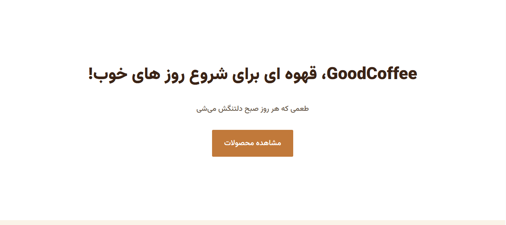

# GoodCoffee

A responsive landing page for a coffee brand, built with HTML, CSS and JavaScript.

🔗 **Live Demo:** https://amir0rr.github.io/GoodCoffee/



## Features

- Fully responsive layout (desktop, tablet, mobile)
- Custom fonts
- Smooth scrolling between sections
- Persian (RTL) support with a custom font (Vazirmatn)

## Built With

- HTML5
- CSS3 (Flexbox, Grid, media queries)
- JavaScript

## What I Learned

- Using media queries for different screen sizes
- Building responsive layouts with Flexbox and Grid

## Run Locally

```bash
git clone https://github.com/Amir0rr/GoodCoffee.git
```

Then open `index.html` in your browser.
